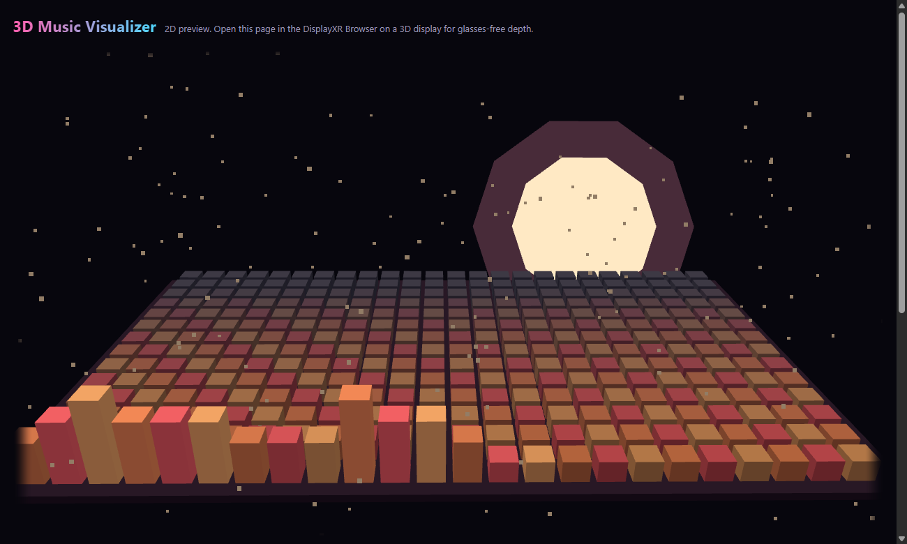
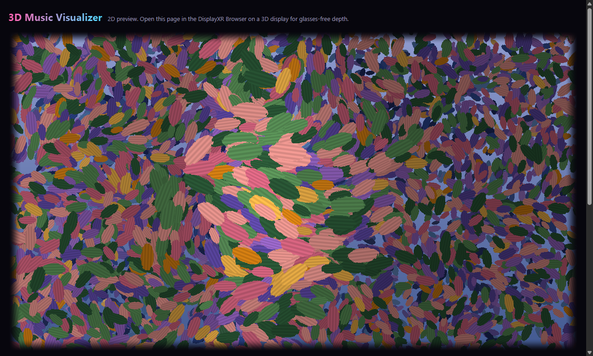
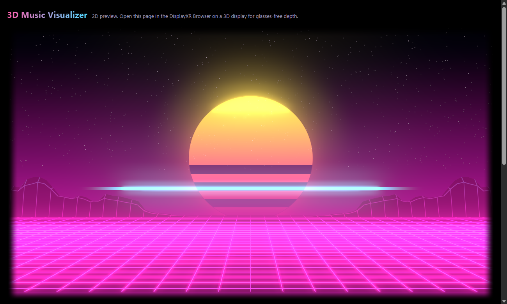
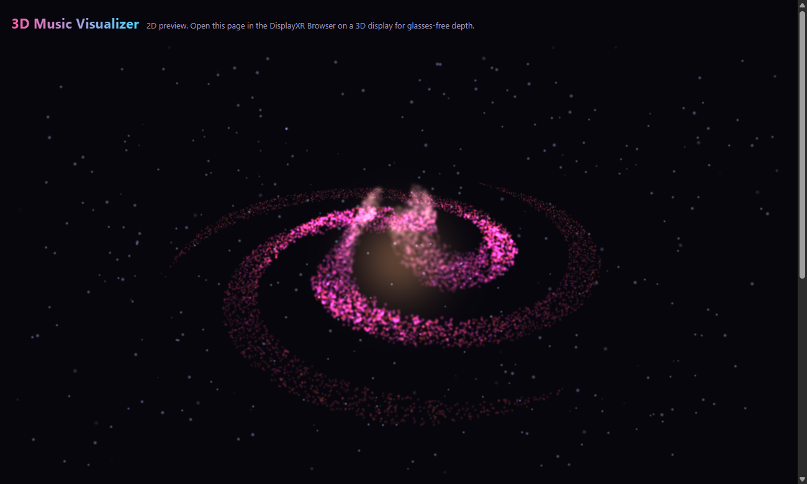
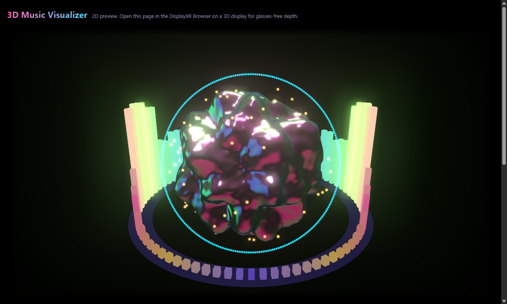

# 3D Music Visualizer

A music visualizer with real depth on glasses-free 3D displays. It plays music from **Spotify** or
**YouTube** inside the page, or follows anything else the PC plays. It's built on
[DisplayXR](https://displayxr.org), so on a Leia SR display in the DisplayXR Browser the visuals
come out of the screen and you can look around them. In any other browser it runs in 2D.

**Open it:** https://joehillthunder.github.io/displayxr-music-visualizer/

| Lo-Fi Room | Impressionist Garden | Neon Horizon |
|---|---|---|
|  |  |  |

| Cosmic Nebula | Liquid Orb |
|---|---|
|  |  |

## Music services

| Service | What you get | What it needs |
|---|---|---|
| **Spotify** | Sign in; the page becomes a Spotify Connect speaker called "3D Music Visualizer" (pick it from the Spotify app on your phone); paste links; now playing, album art, play/pause/skip | A Spotify app client ID (below). In-page playback needs **Premium**; on Free, play in the Spotify app and use Listen to PC audio, and now playing still follows along |
| **YouTube / YouTube Music** | Paste a video or playlist link; the player sits in the page; title and thumbnail | Nothing |
| **Anything else** | Capture PC audio (any app, a Bluetooth or AirPlay receiver), a microphone or line-in, a local file, or the built-in demo loop | Nothing |

**Why the page "listens to this tab".** Spotify protects its audio with DRM, and
the YouTube player runs in a locked cross-origin frame, so no web page can read their audio
directly. Spotify has also closed its audio-analysis API to new apps. So the page plays the
music itself and then captures its own tab's audio for analysis. When Chrome asks, pick **This
tab** and keep **Share tab audio** on. That's one click per session. The audio is only analyzed
in the page and is never recorded or uploaded.

### Setting up Spotify (one time)

1. Open the [Spotify developer dashboard](https://developer.spotify.com/dashboard) and create an app.
2. Add the Redirect URI `https://joehillthunder.github.io/displayxr-music-visualizer/`. The page
   shows the exact URI to copy. For local testing, also add `http://127.0.0.1:<port>/`.
3. Under APIs, tick **Web API** and **Web Playback SDK**.
4. Put the app's Client ID in `js/config.js` (`SPOTIFY_CLIENT_ID`), or paste it into the Spotify
   tab of the page, which keeps it in that browser only.
5. While the app is in development mode, add each listener's Spotify account under
   **User Management** in the dashboard.

The client ID isn't a secret: sign-in uses PKCE, so there's no client secret and no server.

Apple Music isn't built in. To visualize it, play it in the Apple Music app or web player and use
**Other sources → Capture PC audio**.

## Styles

| # | Style | What it looks like | How it uses depth |
|---|---|---|---|
| 1 | **Lo-Fi Room** | A voxel spectrogram with glowing LED caps, a low-poly moon, rain on the glass and drifting dust | The newest spectrum row sits at the glass and older rows scroll back into the screen. Rain falls on a pane in front of the glass |
| 2 | **Impressionist Garden** | 15,000 brushstrokes shaded like thick paint, following a flow field over a moving painted reflection | Strokes sit in layers, from hazy water far behind the glass to a few dabs in front. Each beat sends a ripple toward you from the louder stereo side |
| 3 | **Neon Horizon** | Synthwave grid landscape, a striped sun and a waveform laser | The left channel shapes the left mountains and the right channel the right ones, and they roll out of the screen toward you |
| 4 | **Cosmic Nebula** | A 26,000-star spiral galaxy, bass in the core and highs in the arms, ringed by the live waveform | The tilted disc hangs behind the glass and leans toward the louder channel. Beats send a shockwave that lifts stars toward you |
| 5 | **Liquid Orb** | Iridescent liquid chrome with studio reflections inside a ring of stereo spectrum bars | The orb sits in the glass, and the front of the ring and the beat sparks come out of the screen |

### Layouts, pop-out and motion

Each style has three **layouts** that blend into each other over a few seconds. They change on a
beat every ~28 s (**Change on the beat**), or with `V` or the Layout buttons:

| Style | Layouts | What comes out of the screen |
|---|---|---|
| Lo-Fi Room | **Table** · **Wall** (the bars extrude straight toward you) · **Turntable** (the deck spins in mid-air) | Voxel sparks thrown off the loudest bars on each beat; rain and dust in front of the glass |
| Impressionist Garden | **Garden** · **Starry Night** (strokes wheel around vortices) · **Field** (the painting tilts back into a meadow) | Petals blowing out of the painting, with a flurry on each beat |
| Neon Horizon | **Road** · **Flyover** · **Canyon** | Neon wireframe shapes that race down the road toward you on the beat; the waveform laser in front of the glass |
| Cosmic Nebula | **Spiral** · **Face-on** (the core bulges out of the glass) · **Orbit** (the galaxy turns so its arms swing toward you) | Comets streaking out of the deep field on the beat; shockwave-lifted stars; near-field dust |
| Liquid Orb | **Ring** · **Sunburst** (the bars shoot straight out of the screen) · **Gyro** (the ring precesses around the orb) | Chrome satellites orbiting in front of the glass and behind it; beat sparks |

Everything that comes out of the screen stops and fades about 5 cm in front of the glass (at the
0.12 m virtual display scale) and shrinks near the window edges, where the frame would cut it
off. The whole scene also sways slowly, so the depth keeps changing in quiet passages. The
**Depth** slider scales how far everything reaches in and out.

**Match colours to album art** (on by default) pulls five colours from the cover of whatever is
playing and fades every style to them.

## Rendering and analysis

- **Per-eye post-processing:** each eye renders into a 4x multisampled HDR target, then goes
  through bloom and an output pass into its half of the side-by-side canvas. The Quality menu
  sets this: Ultra (4x MSAA, up to 2560 px per eye), High (2x, up to 1920 px) or Fast (none). The
  **Glow** slider scales the bloom.
- **DisplayXR runtime:** the canvas is an inline-3D window (`createInline3D` + `addScene`), so the
  DisplayXR Browser weaves it through the DisplayXR runtime, with eye-tracked views per frame. The
  page logs its state to the console: `[visualizer] firstWoven woven=… confirmed=…` once, then
  stereo and mono frame counts every 5 s. On the Leia demo PC (DisplayXR runtime 2.43.4), the
  browser reported the window woven (`confirmed=true`), and after start-up every frame was stereo.
- **Audio:** an 8192-point FFT reduced to 128 log-spaced bands (25 Hz to 18 kHz) with fast attack
  and slower release; a left/right analyser pair for stereo placement; the time-domain waveform;
  onset detection from low-weighted spectral flux; and a tempo (BPM) estimate from the onset
  intervals. Slow auto-gain keeps quiet and loud sources in range.

## Controls

`1`–`5` pick a style · `←` `→` previous/next · `V` next layout · `Space` play/pause · `A`
auto-cycle styles (on a beat every ~40 s) · `F` full view · `Esc` exit.

URL parameters: `?style=lofi|impressionist|synthwave|nebula|orb`, `?var=0|1|2` (layout),
`?novary` (hold the layout), `?auto`,
`?quality=ultra|high|fast`, `?glow=0..2`, `?tab=spotify|youtube|more`, and `?demo`, which
starts the demo loop at once.

## Hardware

- **For 3D:** a Leia SR glasses-free 3D display on Windows, running the
  [DisplayXR Browser](https://displayxr.org/browser).
- **Anywhere else:** any modern desktop browser shows it in 2D, with slight mouse parallax.
  Capturing tab or PC audio needs a Chromium browser (Chrome or Edge) on Windows or ChromeOS.
- Spotify's in-page player needs a browser with Widevine DRM. If the DisplayXR Browser build
  doesn't include it, play in the Spotify app and use **Listen to PC audio**; the now-playing card
  and controls still work.

## How it works

- Plain ES modules with no build step: [three.js](https://threejs.org) 0.161 (with its
  post-processing add-ons) and [`@displayxr/inline3d`](https://www.npmjs.com/package/@displayxr/inline3d)
  1.45.1, pinned from jsDelivr through an import map.
- `js/main.js`: one persistent woven canvas (`createInline3D` + `addScene`) that renders each
  eye at a 0.12 m virtual display height. It follows the DisplayXR
  [woven-canvas rules](https://github.com/DisplayXR/displayxr-web/blob/main/docs/woven-canvas-rules.md):
  it never remounts the canvas, covers it until `firstWoven`, validates views before clearing and
  replays the last good frame, clamps the SBS buffer size, uses `rectCover` for full view, and puts
  no CSS effects on the canvas.
- `js/audio.js`: capture and analysis, plus the demo synth. `js/palette.js`: album-art palette
  extraction.
- `js/services/`: Spotify (PKCE sign-in, Web Playback SDK, Web API) and YouTube (IFrame API).
  `js/config.js` holds the optional Spotify client ID.
- `js/styles/*.js`: one file per style, all with the same small interface (see
  `js/styles/common.js`). Each is authored in metres around the z = 0 glass plane, where +z is
  toward the viewer. Shader colours are authored in sRGB and converted to linear, so they match
  with and without post-processing. Adding a style means adding a file and listing it in
  `STYLES` in `main.js`.

Run it locally by serving the folder with any static server and opening it in a browser.

## License

[Apache 2.0](LICENSE). The demo loop is synthesized in the browser, so no audio assets ship with
the app.
